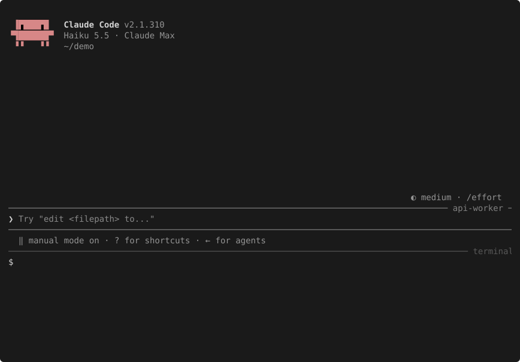

# Claude Code inbox socket

Every running Claude Code session listens on a Unix socket (a named pipe on
Windows). Write a line of JSON to it and the session reads it, starting a new
turn if it was idle.

Unofficial. Not affiliated with or endorsed by Anthropic.

A session that waits on CI, a deploy or a long test run has no way to hear
that it finished; you come back and tell it. Claude Code's sessions already
message each other through this socket, and a script can too. The line format
is not documented, so this repo writes it down and checks it. Anthropic's
supported route, Channels, needs a plugin and a flag; see
[the comparison](#socket-or-channels).

```sh
# from a hook or a Bash command inside the session
printf '%s\n' '{"type":"user","message":{"content":"CI: build 482 is green"}}' \
  | nc -N -U "$CLAUDE_CODE_MESSAGING_SOCKET"
```



Claude Code 2.1.310. Top: an idle session named `api-worker`. Bottom: a shell.
`./run-tests` stands in for a slow test suite. Replay it in a terminal with
`asciinema play demo/inbox.cast`.

## What is here

- [SPEC.md](SPEC.md): the front page of a descriptive spec of the socket. The
  pages are under [spec/](spec): transport, frames, delivery, errors, security
  and platforms. Each ends with an evidence table that says how every claim is
  known: OFFICIAL, OBSERVED, THIRD-PARTY or UNVERIFIED.
- [conformance/check.py](conformance/check.py): re-checks the spec against the
  `claude --version` you have. It starts throwaway `claude -p` sessions, which
  cost a few cents.
- [examples/](examples): `send.py`, `send.mjs` (Node, no dependencies) and
  `send.sh` post a message;
  `waiter.py` waits for a command or a file, then nudges its own session.
- [CHANGELOG.md](CHANGELOG.md): which versions were checked, and what changed.
- `make check`: lints the evidence tables and the links, checks the counts in
  the summary table, runs shellcheck, and tests the example clients against a fake
  receiver. No Claude Code needed, no cost.

## How it works

The socket is named after the session's process id, in a directory only your
user can enter (`$XDG_RUNTIME_DIR/cc-socks/<pid>.sock` on Linux). Claude Code
exports its path to hooks and Bash commands as `CLAUDE_CODE_MESSAGING_SOCKET`
and lists every session in `~/.claude/sessions/<pid>.json` (under
`$CLAUDE_CONFIG_DIR` when that is set).

A client connects, writes one JSON object per line and closes its write side.
A `user` frame carries text. A busy session reads it between tool calls; an
idle one starts a new turn with it. The model sees the text marked as coming
from another Claude session, never as your own words. Nothing comes back on
that connection. Receipts for held, denied, refused, dropped or expired
messages, and for a held message later delivered, arrive on a socket of the
sender's own, if the sender named one.

Anthropic documents the environment variables, the auth line and the delivery
rules. The frame itself is not documented and not a public interface. It was
read out of the shipped binary and checked live.

## Use it

From anywhere on the machine, standard library only:

```sh
python3 examples/send.py --list                      # live sessions and their sockets
python3 examples/send.py --name api-worker --from-name ci "build 482 green, 214 passed"
python3 examples/send.py --pid 12345 --receipts 10 "hello"   # and wait 10 s for receipts
```

`--from-name` gives the message a sender, shown as one line in the session.
Inside a session, `python3 examples/waiter.py --detach -- make test` returns at
once and wakes the session when `make test` exits. `examples/send.sh` posts
with nc or socat.

## Socket or Channels?

[Channels](https://code.claude.com/docs/en/channels) is Anthropic's supported
way to push events, a CI webhook included, into a running session. Use it if
it fits. The socket is for what it does not cover.

| | inbox socket | Channels |
|---|---|---|
| Status | internal; the frame can change in any release | official, research preview |
| What you run | nothing; every session already listens | an MCP server installed as a plugin; a custom one needs `--dangerously-load-development-channels`, or an admin's allowlist, during the preview |
| Per-session opt-in | none; `crossSessionInbound` turns it off | `--channels` at start |
| Login and providers | any; Bedrock, Google Cloud's Agent Platform and Foundry included (2.1.248 and later) | claude.ai or a Console API key; not on Bedrock, Agent Platform or Foundry; Team and Enterprise admins must enable it |
| Who can send | any process of your OS user, on this machine | the senders on the plugin's allowlist, from wherever the server listens |
| Replies | none; receipts only for undelivered messages | two-way, through the plugin's tools |
| Permission prompts | a message cannot approve one | allowlisted senders can approve or deny, if the plugin relays them |
| `claude -p` | yes | yes |

## Security

- Any process running as your OS user can post; nothing else on the machine
  can. On macOS and Linux no token is needed.
- The sender's name, reply address and permission class are what the sender
  writes. A bypassing session's hold gate trusts the class it is told.
- A message cannot approve a permission prompt or run a slash command, but it
  acts with whatever the session may do without asking. A `priority: "now"`
  frame closes an open permission prompt as if you had said no.
- Do not paste CI logs, issue titles or other text you do not control into a
  message: it reaches the model as a request. Post a fixed line and let the
  session read the log.
- No receipt means accepted, unless you named no reply socket: then a held
  message looks the same. Use `send.py --receipts` when nobody watches the
  receiving session.

Details and how each point is known: [the security page](spec/security.md).
`crossSessionInbound: "refuse"` turns it off.

## License and credits

MIT, see [LICENSE](LICENSE). Sources: the official
[cross-session messaging](https://code.claude.com/docs/en/cross-session-messaging)
page, and [claude-code-socket-transport](https://github.com/PeterSR/claude-code-socket-transport)
by PeterSR, the Go client that first wrote the frame down. Versions checked:
[CHANGELOG.md](CHANGELOG.md).
